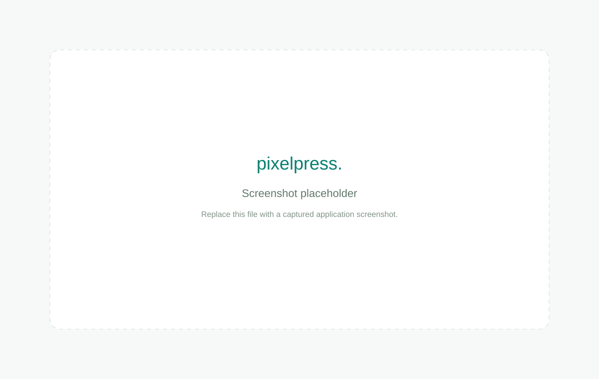

# browser-image-optimizer

Pixelpress is a single-page, local image optimizer built with Vite, React, strict TypeScript, Tailwind CSS, and lucide-react. Image processing uses browser Canvas/Blob APIs only. No backend, accounts, network uploads, processing service, or batch mode.

## Run

Requires Node.js 20.19+ or 22.12+ and npm.

```sh
npm install
npm run dev
```

Open the local URL printed by Vite. The development server only serves the application; images stay in your browser.

```sh
npm run typecheck
npm run build
npm run preview
```

`build` checks TypeScript and writes a static production bundle into `dist/`. Deploy that directory to any static host. No runtime server or API is needed. `preview` serves the production bundle locally.

## Use

1. Drop one PNG, JPEG, or WebP file, or choose one with the file picker.
2. Select JPEG, PNG, or WebP output. Adjust lossy quality or enable a maximum width.
3. Convert and compare previews, pixel dimensions, actual byte counts, and percentage change.
4. Download the generated file. Reset clears the image and restores default settings.

## Behavior and limits

- File signatures are checked; empty, unsupported, corrupt, and over-25-MiB files produce useful errors.
- Decoded images are limited to 40 megapixels and 16,384 pixels on either side. Browser memory limits still vary; very large compressed images can consume memory while decoding before dimensions can be checked.
- Resize preserves aspect ratio to the nearest pixel and never upscales.
- JPEG receives an opaque white background. PNG and WebP retain transparency where supported.
- `createImageBitmap` requests EXIF orientation with `imageOrientation: 'from-image'`. An HTML image decoding fallback uses the browser's orientation handling. Actual orientation support depends on the browser.
- PNG uses lossless encoding; its quality slider is disabled. Re-encoding is not guaranteed to reduce size. Larger results are clearly labeled.
- Export MIME type is checked to detect silent browser fallback to PNG. Null/empty Canvas exports and decoding errors are handled.
- Object URLs are revoked on replacement and unmount; temporary decoding URLs are revoked, bitmaps are closed, and canvas memory is released. A generation counter prevents obsolete asynchronous work replacing newer state.
- Output is a single raster frame: animation and source metadata are not preserved. Canvas/browser color management may change rendering.
- There are no external fonts, remote images, analytics, API calls, or image uploads. The browser loads app assets from its host; image processing is local.
- Current Chrome, Edge, Firefox, and Safari are recommended. Format encoding support and Canvas limits depend on the browser.

## Source

- `src/App.tsx`: accessible single-image workflow and previews.
- `src/image.ts`: signature validation, orientation-aware decoding, resizing, and export.
- `src/styles.css`: responsive design with Tailwind CSS integration.
- `docs/screenshot-placeholder.svg`: explicitly labeled placeholder; replace with a real application screenshot when available.

No tests are included, as requested.


